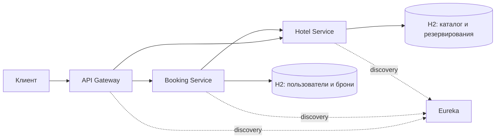

# Hotel Booking System

REST API для бронирования отелей на Kotlin и Spring Boot 3.5. Поддерживает регистрацию пользователей, управление каталогом, подбор свободных номеров, бронирование, отмену и отчёты о загрузке.

## Запуск

Нужны Docker Engine и Docker Compose v2 (2.20+). Для сборки необходим доступ к Maven Central и Gradle Plugin Portal; для Docker выделите не менее 4 GiB памяти. JDK 21 на хосте нужен только для Gradle-команд наполнения и тестирования. Gradle и зависимости загружаются автоматически через Wrapper.

Из корня проекта:

```sh
docker compose up --build --wait --wait-timeout 180
curl --fail http://localhost:8080/health/hotel
curl --fail http://localhost:8080/health/booking
```

Оба запроса должны вернуть `"status":"UP"`.

- API: `http://localhost:8080`.
- [Swagger UI](http://localhost:8080/swagger-ui.html): описание и вызов методов Booking и Hotel.
- [Eureka](http://localhost:8761): зарегистрированные сервисы.

Если порты заняты, задайте другие: `GATEWAY_PORT=18080 DISCOVERY_PORT=18761 docker compose up --build --wait`. В последующих запросах используйте выбранный порт Gateway.

Логи: `docker compose logs --follow api-gateway booking-service hotel-service`. Остановка: `docker compose down`.

Данные хранятся в H2 in-memory и теряются при остановке сервисов. Для чистого запуска или после перезапуска отдельного backend выполните общий сброс:

```sh
docker compose down
docker compose up --build --wait --wait-timeout 180
```

После сброса нужно войти заново и повторить наполнение, если оно использовалось.

## Демонстрационные данные

При запуске Compose создаются два отеля, четыре номера, прошлое проживание и учётные записи:

| Роль | Логин | Пароль |
|---|---|---|
| USER | demo-user | demo-user-password |
| ADMIN | demo-admin | demo-admin-password |

Для демонстрации будущих бронирований и отмены выполните (нужен JDK 21):

```sh
./gradlew :verification:run --args="http://localhost:8080"
```

Команда создаёт две будущие брони и одну отменённую, проверяет историю, отчёт о загрузке и счётчики. Повтор в тот же UTC-день не создаёт дубликатов. После смены даты или ручного изменения демонстрационных данных сначала выполните общий сброс. Состав данных описан в [demo-fixtures](demo-fixtures/README.md).

## Использование API

В Swagger UI выберите Booking и вызовите `POST /api/users/auth`:

```json
{"username":"demo-user","password":"demo-user-password"}
```

Скопируйте `accessToken` из ответа в **Authorize → bearerAuth**, без префикса `Bearer`. При вызове через HTTP-клиент передавайте заголовок `Authorization: Bearer <accessToken>`. Токен действует один час. Нового пользователя можно создать через `POST /api/users/register` с такими же полями.

1. Вызовите `GET /api/bookings/recommendations` с будущими `startDate` и `endDate` (выезд позже заезда). Сохраните `id` свободного номера.
2. Вызовите `POST /api/bookings` с новым `Idempotency-Key`, например `demo-booking-1`, и телом ниже. Подставьте ID номера и те же даты:

   ```json
   {
     "autoSelect": false,
     "roomId": "<UUID номера>",
     "startDate": "<YYYY-MM-DD>",
     "endDate": "<YYYY-MM-DD>"
   }
   ```

   Успех — `201`, `status=CONFIRMED`. Повтор с тем же ключом и параметрами возвращает ту же бронь. Для автоподбора передайте `autoSelect: true` и `hotelId` вместо `roomId`.
3. Проверьте историю через `GET /api/bookings`, отдельную бронь — через `GET /api/bookings/{id}`.
4. Отмените бронь через `DELETE /api/bookings/{id}` до даты заезда. Ответ `200` означает завершённое освобождение, `202` — продолжающуюся компенсацию; её результат доступен через GET в поле `compensationStatus` (`DONE` после завершения).

Даты трактуются по UTC, интервал проживания не включает день выезда. Рекомендации не удерживают номер: при `409 ROOM_UNAVAILABLE` повторите поиск и используйте новый ключ для новой брони.

Для административных операций войдите как `demo-admin` и используйте его токен. Например, в разделе Hotel вызовите `GET /api/hotels/{id}/occupancy` с ID отеля и параметрами `from`, `to` для отчёта о загрузке. USER имеет доступ только к своим бронированиям; ADMIN также может просматривать и отменять чужие. Без токена защищённые методы возвращают `401`, без необходимых прав — `403`.

### Эндпойнты

| Методы и маршруты | Назначение | Доступ |
|---|---|---|
| POST `/api/users/register`, `/api/users/auth` | Регистрация и вход | Без токена |
| GET `/api/users/jwks` | Публичные ключи JWT | Без токена |
| POST/GET `/api/users`, GET/PUT/DELETE `/api/users/{id}` | Управление пользователями | ADMIN |
| POST/GET `/api/bookings`, GET/DELETE `/api/bookings/{id}` | Создание, история, чтение, отмена | USER/ADMIN |
| GET `/api/bookings/recommendations` | Подбор свободных номеров | USER/ADMIN |
| GET `/api/hotels`, `/api/hotels/{id}`, `/api/rooms`, `/api/rooms/{id}`, `/api/rooms/recommend` | Каталог и поиск | USER/ADMIN |
| POST `/api/hotels`, `/api/rooms`; PUT/DELETE `/api/hotels/{id}`, `/api/rooms/{id}` | Изменение каталога | ADMIN |
| GET `/api/hotels/{id}/occupancy` | Отчёт о загрузке | ADMIN |

Параметры, ответы и ограничения описаны в [Booking API](booking-service/README.md) и [Hotel API](hotel-service/README.md). OpenAPI JSON доступен через Gateway по `/v3/api-docs/booking` и `/v3/api-docs/hotel`. Служебные `/internal/**` через Gateway недоступны.

## Тестирование

Нужен JDK 21. Обычные тесты и проверка стиля не требуют Docker:

```sh
./gradlew test spotlessCheck
```

Отчёты: `<module>/build/reports/tests/test/index.html`.

Сквозные тесты требуют работающего Docker Engine и Compose:

```sh
./gradlew systemTest
```

Они собирают и запускают отдельный контур на свободных портах, проверяют маршрутизацию, права, конкурентные бронирования и компенсацию сетевого отказа, затем удаляют тестовые ресурсы. Логи: `verification/build/system-test/<project>/`.

[Карта соответствия ТЗ и результаты проверок](docs/acceptance.md). Дополнительные режимы проверки описаны в [verification](verification/README.md).

## Архитектура



Gateway маршрутизирует запросы через Eureka. Booking управляет пользователями и бронированиями, Hotel — каталогом, календарём и аналитикой. Каждый backend самостоятельно проверяет JWT. Бронирование оформляется последовательностью локальных транзакций с компенсацией при сбое.

Архитектурные решения: [безопасность](docs/adr/001-jwt-boundaries.md), [границы сервисов и данных](docs/adr/002-service-boundaries.md), [сага и идемпотентность](docs/adr/003-booking-saga.md).

## Документация модулей

| Модуль | Документация |
|---|---|
| booking-service | [Пользователи, бронирования, безопасность и API](booking-service/README.md) |
| hotel-service | [Каталог, календарь, аналитика и API](hotel-service/README.md) |
| api-gateway | [Маршрутизация и входная проверка JWT](api-gateway/README.md) |
| discovery-server | [Реестр Eureka](discovery-server/README.md) |
| booking-core | [Ядро бронирований и пользователей](booking-core/README.md) |
| hotel-core | [Ядро каталога и резервирования](hotel-core/README.md) |
| web-support | [Общие HTTP/JWT-контракты](web-support/README.md) |
| verification | [Demo-команда и системная приёмка](verification/README.md) |
| demo-fixtures | [Общие демонстрационные данные](demo-fixtures/README.md) |
